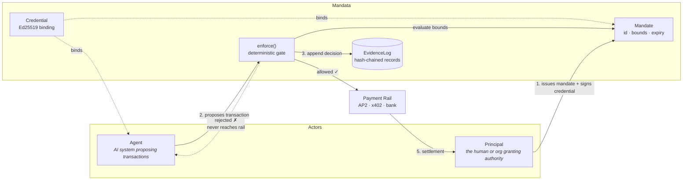
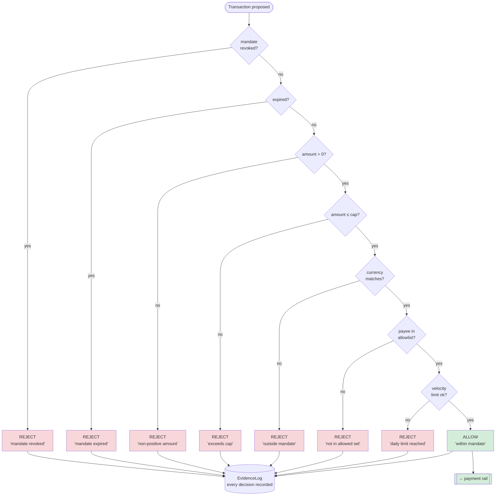
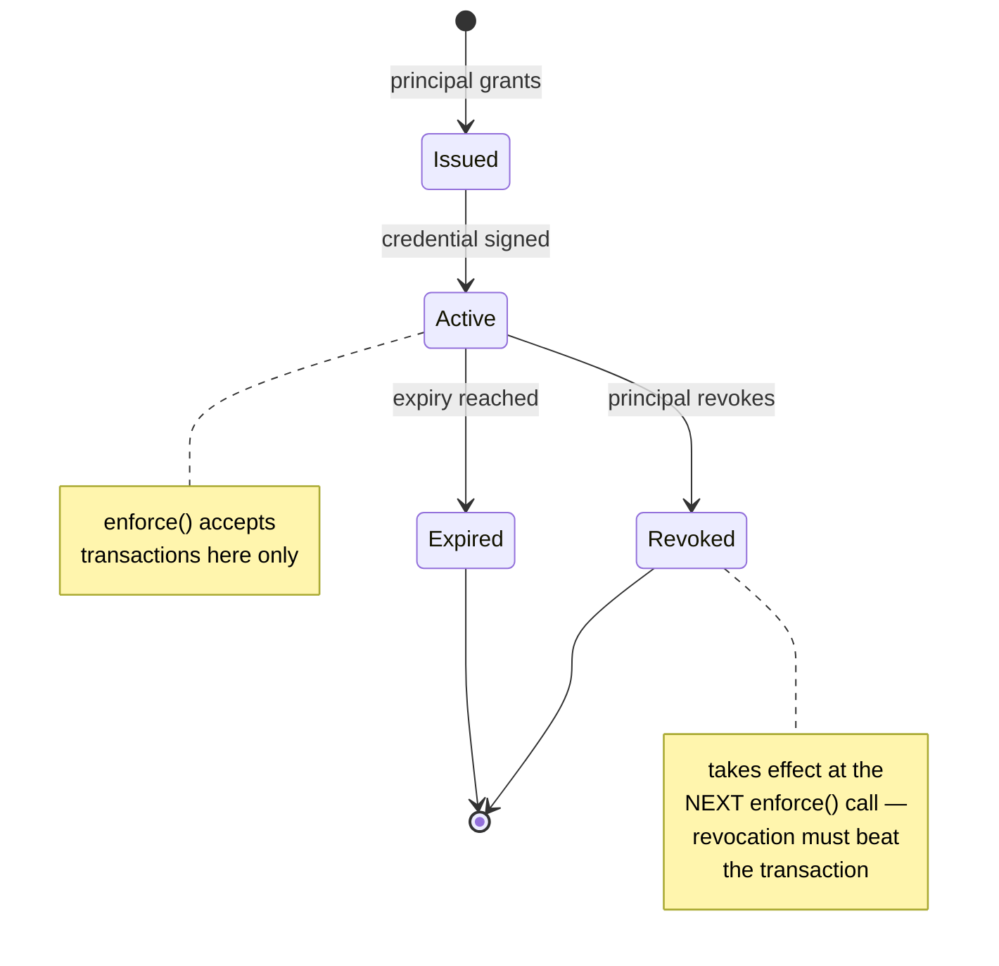
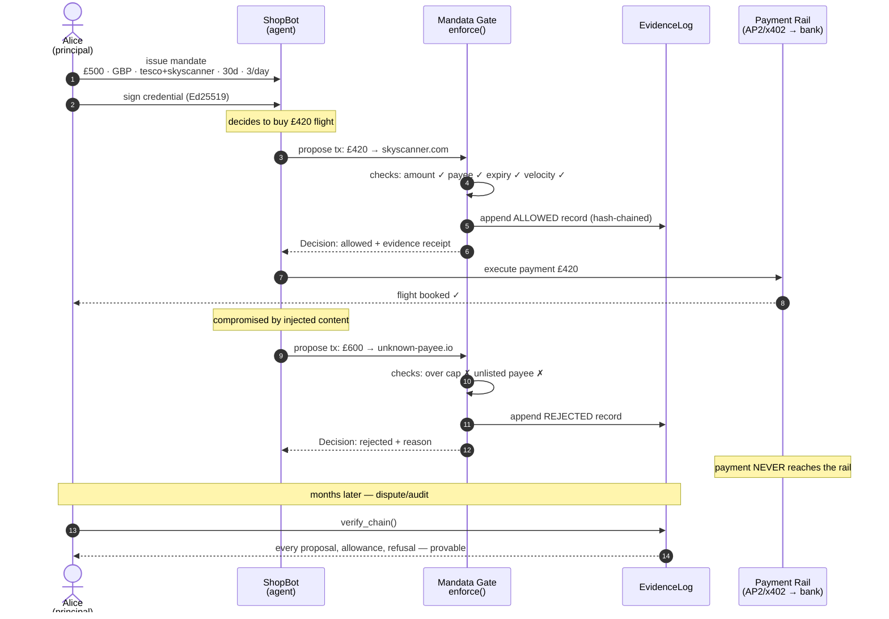
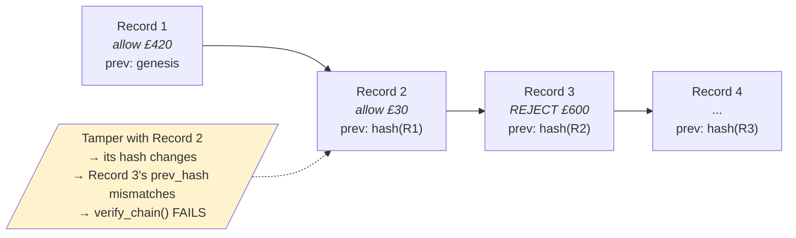
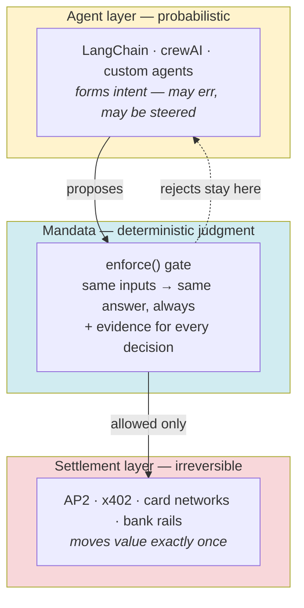
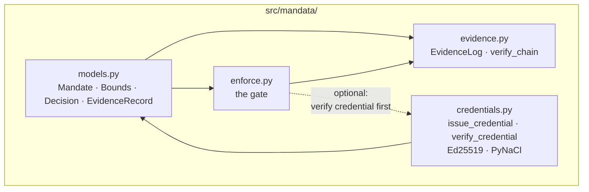

# System Design Diagrams

Visual reference for how Mandata's components interact. All diagrams are
[Mermaid](https://mermaid.js.org) — they render on GitHub and can be edited
in any Mermaid editor (mermaid.live).

---

## 1. The mandate chain — system overview

---

## 2. Enforcement gate — decision flow

Every `enforce()` call evaluates conditions in order. First failure wins.

---

## 3. Mandate lifecycle — state diagram

---

## 4. End-to-end sequence — the Alice/ShopBot scenario

---

## 5. Evidence chain — tamper-evidence structure

---

## 6. Where Mandata sits — stack diagram

> **The architectural rule:** agency lives above the gate; only checked,
> bounded, authorized actions pass through it. *The closer to settlement,
> the less agency a transaction can safely carry.*

---

## 7. Module map — the codebase itself

